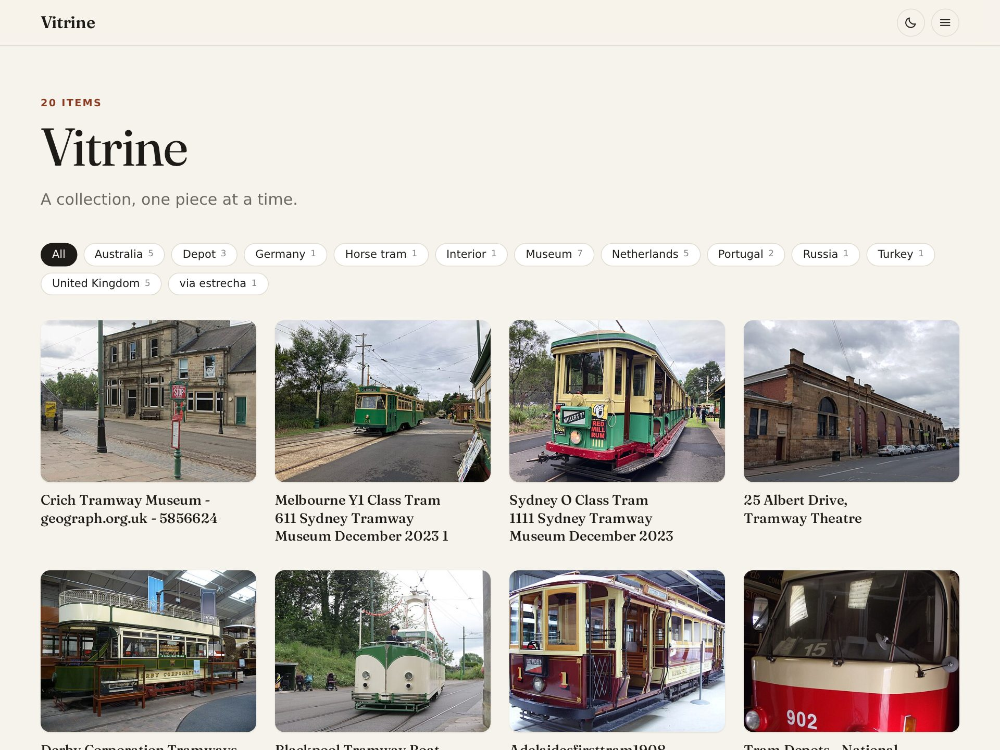
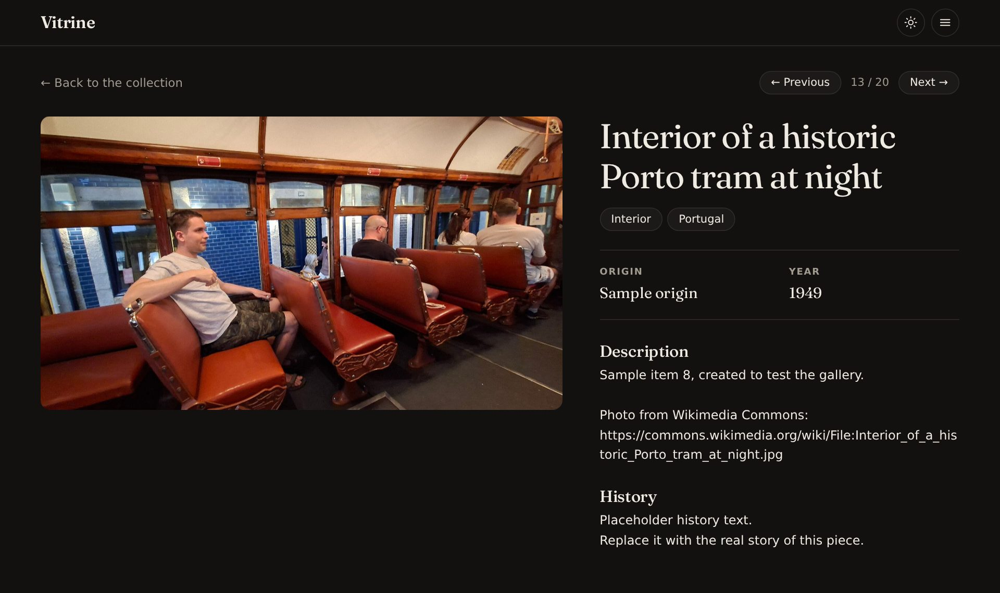
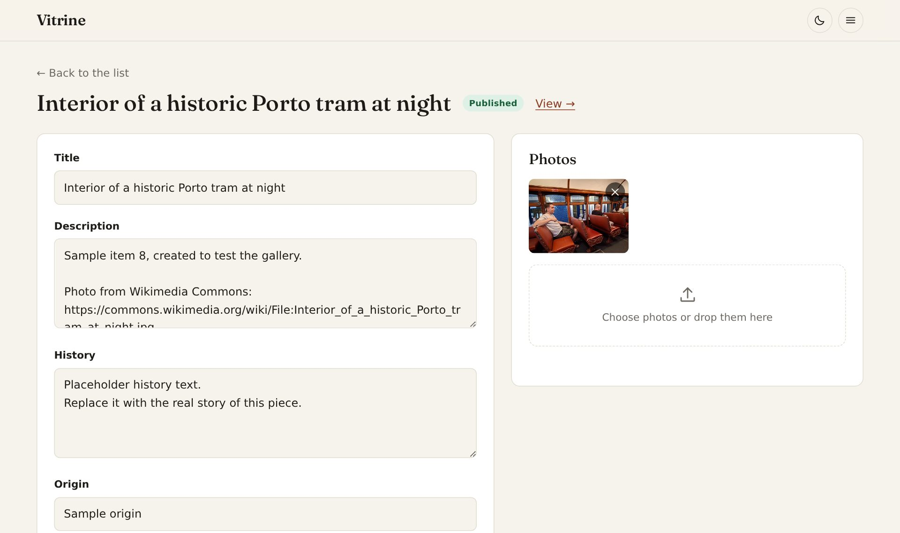
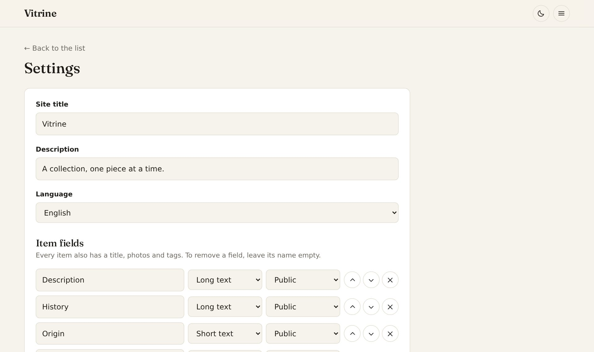
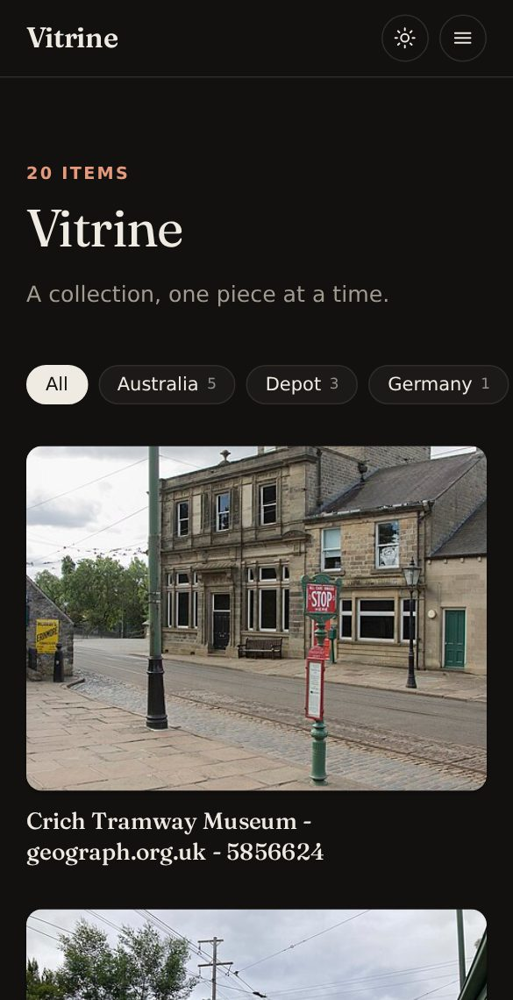

# Vitrine

**A simple gallery for your collection.** Photos, history, origin and prices of every piece, on a site of your own that runs for free on Cloudflare.

[](https://www.padritrams.workers.dev)

**[See it live →](https://www.padritrams.workers.dev)** Padritrams, a tram collection.

## What you get

- **A gallery** anyone can browse, with tags to filter by and one page per piece.
- **An admin panel** behind a password, to add pieces and upload photos from your phone or computer.
- **Your own fields.** Description, history, price… you decide what each piece has, and which fields stay private.
- **No code to edit.** Title, language (English, Spanish or Catalan) and fields are set from the admin panel.
- **Small and free to run.** Photos are shrunk before upload, so thousands fit in Cloudflare's free 10 GB.

| A piece, in the dark theme | Editing a piece |
|---|---|
|  |  |

| Settings | On a phone |
|---|---|
|  |  |

## Get your own

You need a free [Cloudflare](https://dash.cloudflare.com/sign-up) account with R2 enabled. R2 asks for a payment card, but the first 10 GB are free.

[](https://deploy.workers.cloudflare.com/?url=https://github.com/caay2000/vitrine)

The button sets everything up and asks you to choose the admin password. When it finishes:

1. Open `/admin` on your new site and log in.
2. In the menu, go to **Settings** and set the title, language and fields of your collection.
3. Start adding pieces.

<details>
<summary>From the command line instead</summary>

```sh
git clone https://github.com/caay2000/vitrine.git && cd vitrine
npm install
npx wrangler login
npm run deploy
npx wrangler secret put ADMIN_PASSWORD
```

To publish several collections from the same copy of the code, give each one its own Wrangler config file (copy [`wrangler.jsonc`](wrangler.jsonc) and change `name`, `database_name` and `bucket_name`) and point to it when deploying:

```sh
VITRINE_WRANGLER_CONFIG=/path/to/other-site/wrangler.jsonc npm run deploy
```

</details>

## Development

Built with [Astro](https://astro.build) on Cloudflare Workers, with D1 for the data and R2 for the photos. Requires Node 22.12 or newer.

```sh
npm install
cp .dev.vars.example .dev.vars   # sets the local admin password
npm run dev
```

The site is at http://localhost:4321 and the admin panel at http://localhost:4321/admin. Local data lives in `.wrangler/`.

Database changes go in [`migrations/`](migrations) as numbered SQL files; the app applies the pending ones on its own when it starts.

## License

[MIT](LICENSE). The photos in the screenshots are by Wikimedia Commons contributors; see [the credits](docs/screenshots/README.md).
